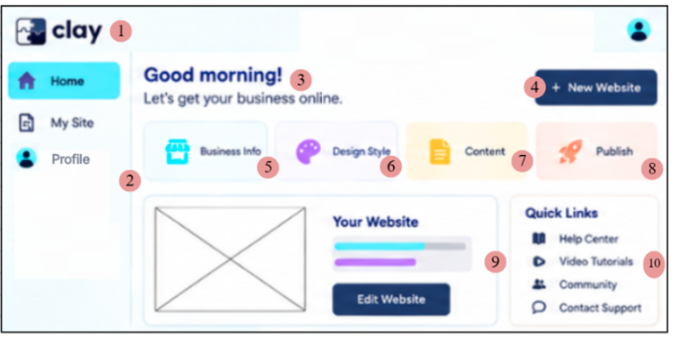
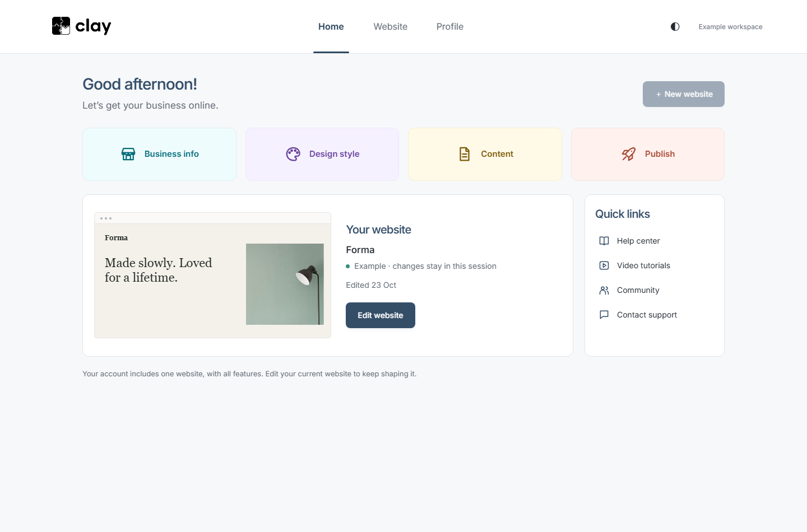
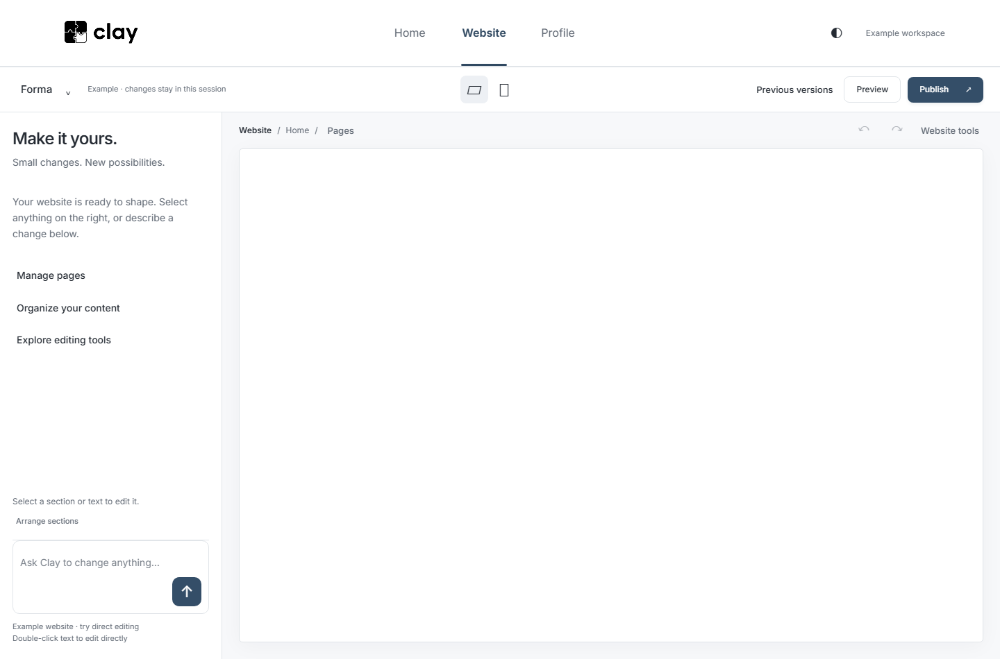
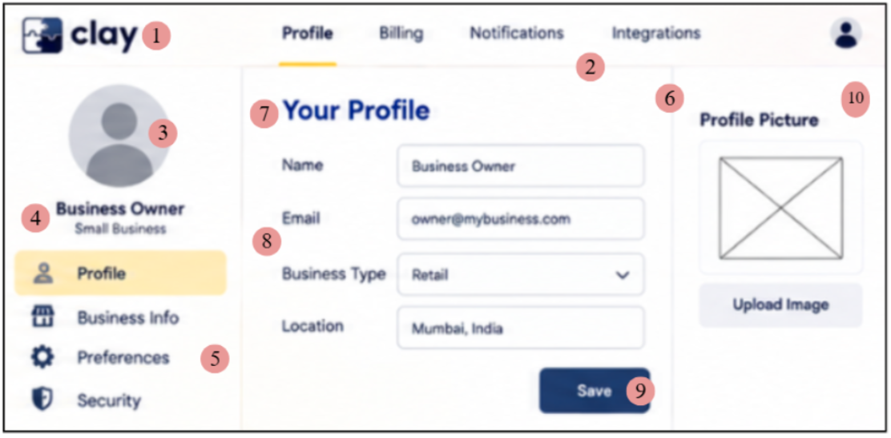
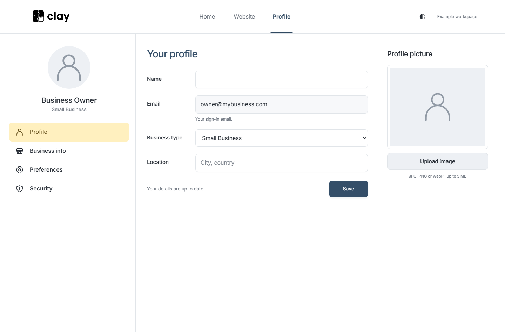
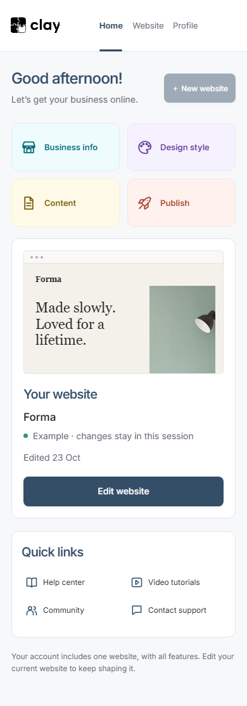
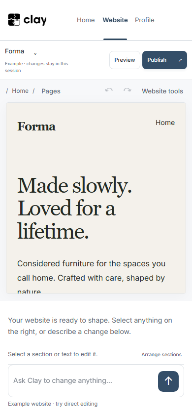
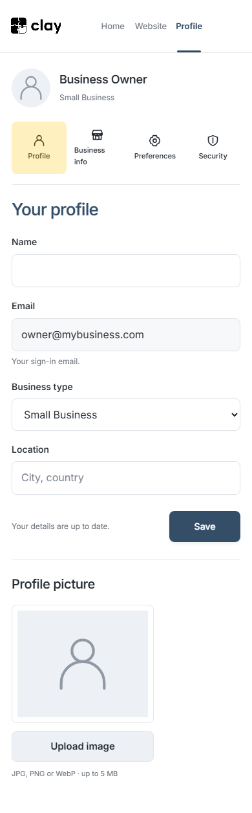
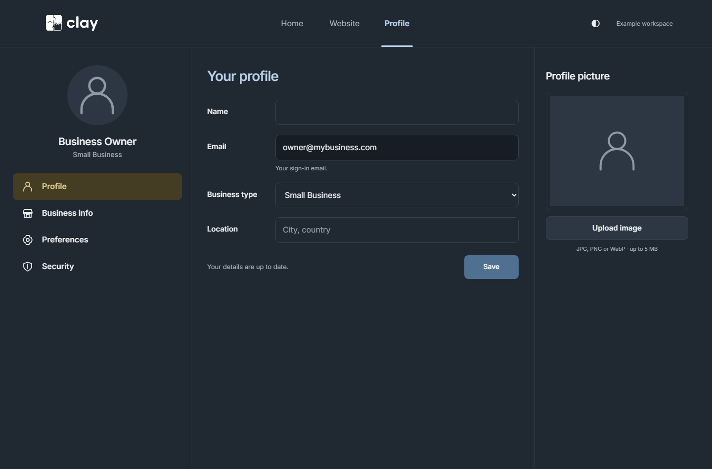

# Clay design changes — 23 October 2026

This revision follows the supplied Home and Profile references. The required structural corrections are: remove the splash; use Home / Website / Profile in the header; keep Home as an overview; open the full editor only in Website; and use the three-column Profile layout with picture upload. These corrections are separate from the small refinements below.

## Home — three refinements

| ID | Small change from the reference | Design principle | Reason for the change |
| --- | --- | --- | --- |
| H1 | Use softer shortcut backgrounds and familiar outline icons alongside the existing text labels. | Recognition rather than recall; accessible contrast. [1] | Owners can identify Business info, Design style, Content and Publish by reading or recognising the symbol. Colour is supplementary. |
| H2 | Keep **Edit website** as the strongest action inside the website preview area; give it a minimum 44px height. | Visual hierarchy; Fitts’s law / target acquisition. [2, 3] | The most common next step is prominent and easy to tap. |
| H3 | Replace the reference’s unlabelled decorative bars with the real website status and last-edited date, directly beside the preview. Explain the one-website limit below. | Visibility of system status; proximity. [1, 4] | The information reflects the saved website and explains why New website becomes unavailable after one website exists. |

Preserved: greeting, supporting sentence, New website position, four shortcuts in one desktop row, small website preview on the left, website information alongside it, and Quick links on the right. The header replaces the reference’s Home sidebar as requested. There is no embedded editor on Home.

Reference supplied by the user:

Implemented desktop layout:

## Website — three refinements

| ID | Small change | Design principle | Reason for the change |
| --- | --- | --- | --- |
| W1 | Add an explicit **Website / page name** breadcrumb and keep Website selected in the header. Opening Website also works immediately after sign-in and after a reload. | Consistency and standards; orientation. [1] | The selected destination matches the displayed workspace. |
| W2 | Shorten the selection hint to “Select a section or text to edit it.” Keep the selected element’s context beside the AI input. | Recognition rather than recall. [1] | The next action and the scope of a requested change are visible. |
| W3 | Announce the saved/publishing status as a polite status message. Background saves and undo shortcuts cannot switch Home or Profile into the editor. | Visibility of system status; user control. [1] | Feedback remains available while navigation stays under the owner’s control. |

Preserved: conversation column, permanent AI input, large canvas, page controls, desktop/mobile preview, previous versions and publishing controls. The Website workspace remains the only place with the full website canvas.

## Profile — four refinements

| ID | Small change from the reference | Design principle | Reason for the change |
| --- | --- | --- | --- |
| P1 | Give each field a persistent label and align labels and controls consistently; stack each pair on small screens. | Proximity and alignment. [4] | A label stays visibly connected to its field on desktop and mobile. |
| P2 | Add “You have unsaved changes” and “Changes saved” beside Save. | Visibility of system status. [1] | Owners can tell whether their changes have been stored. |
| P3 | State the accepted image formats/size, display upload progress and show the actual uploaded picture. | Error prevention and feedback. [1] | Owners know what to upload and whether it worked. Pictures are private to their owner. |
| P4 | Explain the read-only sign-in email with a short helper line. | Error prevention; match to the user’s task. [1] | The account email is not confused with the customer-facing contact email, which can be edited in Business info. |

Preserved: left portrait, owner name and business type, Profile / Business info / Preferences / Security menu, active warm-yellow menu item, central Name / Email / Business type / Location form and Save button, and the right Profile picture / Upload image area. The main header uses Home / Website / Profile as requested.

Reference supplied by the user:

Implemented desktop layout:

## Responsive evidence

| Home | Website | Profile |
| --- | --- | --- |
|  |  |  |

## Feature notes

- Google credentials are stored in Supabase, never in public client files.
- Home’s tutorial opens a recorded walkthrough of the real editor. Help center contains working guidance. Community clearly states that a community space is not yet available. Contact support creates a report the owner can share; it does not claim to send a message.
- A single account still has one website. New website becomes disabled once that website exists, with an explanation on the page.
- Analytics and contact messages remain accessible under Profile → Business info → Website activity & messages.
- Screenshots use the explicitly labelled example workspace rather than private customer data.

## Sources

1. [Nielsen Norman Group — 10 usability heuristics](https://www.nngroup.com/articles/ten-usability-heuristics/).
2. [Nielsen Norman Group — Principles of visual design](https://www.nngroup.com/articles/principles-visual-design/).
3. [W3C — Target size (enhanced)](https://www.w3.org/WAI/WCAG22/Understanding/target-size-enhanced). The primary controls use 44px targets; this does not claim full AAA conformance.
4. [Nielsen Norman Group — Proximity principle](https://www.nngroup.com/articles/gestalt-proximity/).

The justifications above apply these established principles to Clay. They are design rationales, not claims that a usability study has already measured an improvement.
